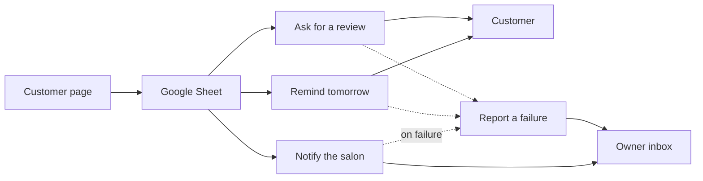
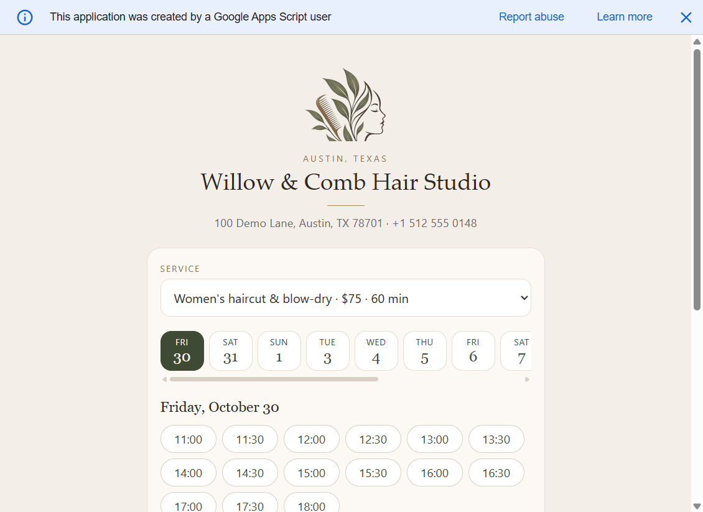
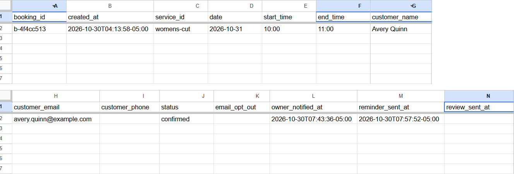
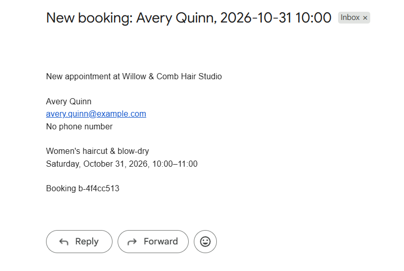
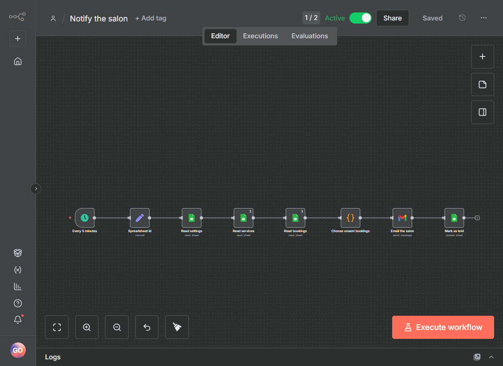
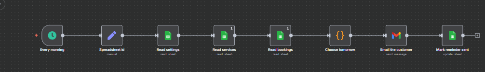
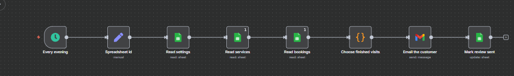
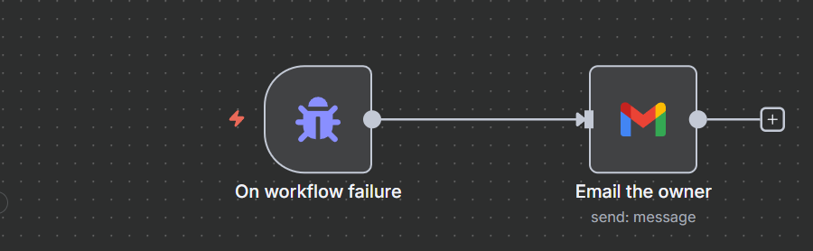

# Willow & Comb

A one-page booking site for a fictional Austin hair studio. The customer picks a service and a time. The owner works in a Google Sheet. n8n sends the mail.

No accounts, payments, or chat. English only.

## How it fits



The page is a Google Apps Script web app. It stays up when the machine running n8n is off. n8n is the free local edition, so mail goes out only while that machine is on.

Live page: https://script.google.com/macros/s/AKfycbyviDGh6xAi4F-o-XeS1zOkYGCVQnEBQFaBDFRJfEwJ7W0mcU-HwvRrwPE0vAC6S6ZB/exec

## Pictures



The customer picks one day, then a time.



One confirmed visit. The salon mail and the reminder are already stamped. The review column stays empty until the visit has ended.



What n8n sends the salon.



Every 5 minutes. New confirmed bookings go to the salon.



08:00 America/Chicago. Tomorrow's customers get a reminder.



19:30 America/Chicago. A visit that already ended today gets a review mail.



If one of those three fails on its schedule, this mails the owner. It stays off. n8n calls it anyway.

## Sheet

Three tabs: Services, Settings, Bookings. Hours, prices, and the salon email live in the sheet, not in code. The 08:00 reminder and the 19:30 review are clocks in n8n. Seed rows are in `src/sheetContract.js`.

Cancel a booking by setting `status` to `cancelled`. Stop customer mail by setting `email_opt_out` to `yes`. The salon still hears about that booking.

## Workflows

Leave these on:

| Workflow | When | What |
| --- | --- | --- |
| Notify the salon | Every 5 minutes | Emails the salon about a new confirmed booking, then writes `owner_notified_at` |
| Remind tomorrow | 08:00 America/Chicago | Emails tomorrow's customers, then writes `reminder_sent_at` |
| Ask for a review | 19:30 America/Chicago | Emails customers whose visit already ended today, then writes `review_sent_at` |

Leave these off:

- **Report a failure.** n8n calls it when one of the three fails. It does not need to be on.
- **Break on purpose.** A test that throws. Turning it on sends a fake failure mail every minute.

Customer mail includes a cancel line and `To stop these emails, reply STOP.` The salon mail does not. There is no confirmation mail.

## Setup

1. `npm run build` writes `apps-script/Rules.gs`.
2. In the Google Sheet, open Extensions, then Apps Script. Put `Code.gs`, `Index.html`, `Rules.gs`, and `appsscript.json` in that project.
3. Run `seedSheet` from the editor. It fills Services and Settings. It clears Bookings.
4. Deploy as a web app. Execute as yourself. Who has access: Anyone.
5. On the machine that should send mail, run `n8n start` and open http://localhost:5678. Import the files in `n8n/`.
6. Connect the Google account on every Sheets node and on Gmail.
7. Replace `PASTE_WILLOW_SHEET_ID` with the id in the sheet URL, between `/d/` and `/edit`. Replace `PASTE_OWNER_EMAIL` with the owner's email.
8. On Notify the salon, Remind tomorrow, Ask for a review, and Break on purpose, open the workflow settings and choose Report a failure as the error workflow. Do not set one on Report a failure. Leave that workflow off, and leave Break on purpose off.

## Checks

```bash
npm test
```

By hand:

1. Book an open time. A confirmed row appears. Within a few minutes the salon gets one mail and `owner_notified_at` fills. Run it again and the same row is quiet.
2. Book that same time again. The page says it was just taken.
3. Monday, the past, the next two hours, and a service that would end after close are not offered.
4. A booking for tomorrow gets one reminder. `email_opt_out` = `yes`, or `status` = `cancelled`, gets none.
5. A visit that already ended today gets one review mail. Tomorrow's visit does not.
6. A failed scheduled run mails the demo inbox with the workflow name and the node. Clicking Execute in the editor does not.

## Decisions

n8n polls the sheet. There is no public webhook. The page takes a lock and checks the slot again before it writes, so two people cannot take the same time. "Tomorrow" and the two daily mails use America/Chicago, including the clock change. Sent times are stored on the row, so a mail is not sent twice.

## Known limits

- Salon mail can lag a few minutes, and only while the machine running n8n is on.
- The 08:00 reminder and the 19:30 review do not catch up if that machine was off.
- The form enforces the rules. A row typed straight into the sheet is trusted.
- A STOP reply is not read. The owner marks the sheet.
- Date columns must stay plain text. A localized date is misread.
- The free Apps Script page shows Google's "created by" banner.
